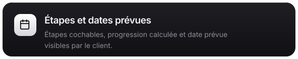
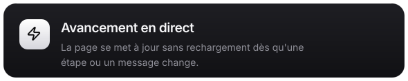
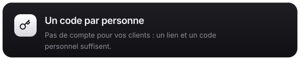
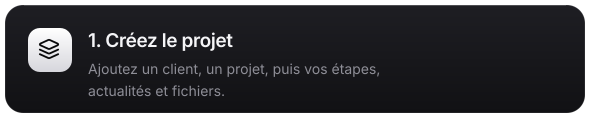
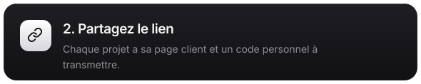
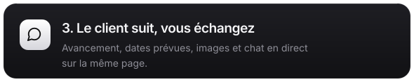

<div align="center">

<a href="https://github.com/Quarkyz/quarkyz-flow"></a>

<a href="https://flow.carreira.website" target="_blank" rel="noopener noreferrer">
  
</a>

<p>
  Créez en quelques minutes une page de suivi de projet <b>à vos couleurs</b>,<br/>
  partagez un lien à votre client et laissez-le suivre l'avancement en direct.
</p>

<p>
  <a href="https://flow.carreira.website/app" target="_blank" rel="noopener noreferrer"></a>
  <a href="https://flow.carreira.website" target="_blank" rel="noopener noreferrer"></a>
  <a href="https://discord.gg/vwdbmyPyJY" target="_blank" rel="noopener noreferrer"></a>
</p>

<a href="https://github.com/Quarkyz/quarkyz-flow"></a>

</div>

<br/>

## ✦ C'est quoi Quarkyz Flow ?

Une interface pensée pour les entreprises, les freelances et les studios qui livrent des projets. Fini les « où en est-on ? » et les informations éparpillées entre mails, messageries et PDF.

Vous gérez vos clients et vos projets depuis un espace clair. Pour chaque projet, Flow génère **une page dédiée, à vos couleurs**, que le client ouvre avec un simple lien et un code personnel. Il y voit :

- les **étapes** du projet et leur avancement, avec la **date prévue** de chacune
- les **images**, actualités et fichiers que vous publiez
- un **chat en direct** pour échanger avec vous sur la même page

Aucun compte à créer pour vos clients.

## ✦ En ligne ou chez vous

Deux façons d'utiliser Quarkyz Flow, toutes les deux gratuites.

| | En ligne | Auto-hébergé |
|---|---|---|
| Prix | Gratuit et illimité | Gratuit |
| Installation | Aucune, un compte suffit | Node.js ou Docker |
| Vos données | Hébergées par Quarkyz | Chez vous, base au choix |
| Fonctionnalités | Celles du dépôt, plus des extras (MCP et d'autres à venir) | Celles de ce dépôt |

<p align="center">
  <a href="https://flow.carreira.website/app"></a>
</p>

Le dépôt contient tout ce qu'il faut pour faire tourner Flow. Certaines fonctionnalités, comme MCP, sont proposées uniquement sur la version en ligne.

## ✦ Fonctionnalités

<p align="center">
  <a href="https://github.com/Quarkyz/quarkyz-flow"></a>
  <a href="https://github.com/Quarkyz/quarkyz-flow"></a>
  <a href="https://github.com/Quarkyz/quarkyz-flow"></a>
  <a href="https://github.com/Quarkyz/quarkyz-flow"></a>
  <a href="https://github.com/Quarkyz/quarkyz-flow"></a>
  <a href="https://github.com/Quarkyz/quarkyz-flow"></a>
  <a href="https://github.com/Quarkyz/quarkyz-flow"></a>
  <a href="https://github.com/Quarkyz/quarkyz-flow"></a>
</p>

## ✦ Comment ça marche

<p align="center">
  <a href="https://github.com/Quarkyz/quarkyz-flow"></a>
  <a href="https://github.com/Quarkyz/quarkyz-flow"></a>
  <a href="https://github.com/Quarkyz/quarkyz-flow"></a>
</p>

| Page | Adresse |
|---|---|
| Site vitrine | `/` (`/fonctionnalites`, `/comment-ca-marche`, `/open-source`, `/acces-client`) |
| Espace de travail | `/app` |
| Page client | `/p/XXXX-XXXX-XXXX`, ouverte par un code personnel |

## ✦ Dernière mise à jour

<!-- PATCHNOTE:START -->

### v0.4.0 · 18 novembre 2026
> Validation des étapes par le client et notifications webhook.

**✨ Nouveau**
- Validation client : le professionnel clique sur « Faire valider », le client répond par **Valider** ou **Demander une modification** (avec un message).
- La réponse apparaît sur l'étape, dans la discussion et chez le professionnel, qui peut « Redemander » après correction.
- Webhook (Réglages › Notifications) : un message est envoyé à chaque message client, validation ou demande de modification. Discord est reconnu directement.

**🔧 Amélioré**
- Les bases existantes reçoivent automatiquement les nouvelles colonnes au démarrage (SQLite, MySQL, MariaDB, PostgreSQL).

**🔒 Sécurité**
- Les adresses de webhook locales ou privées sont refusées, y compris après résolution DNS, et l'adresse n'est jamais visible côté client.

<!-- PATCHNOTE:END -->

<p align="center">
  <a href="./PATCHNOTE.md"></a>
</p>

## ✦ Installation (auto-hébergement)

Node.js 18+ (20+ recommandé), aucune étape de build.

```bash
npm install
npm start          # http://localhost:3000
```

Ou avec Docker (MySQL inclus) :

```bash
docker compose up -d --build
```

`server.js` lit lui-même le fichier `.env` et le crée à partir de `.env.example` s'il n'existe pas. En local, tant qu'aucun fournisseur de connexion n'est configuré, le bouton « Entrer en mode démo » permet d'essayer l'application tout de suite.

**En production** : renseignez `BASE_URL` et les identifiants OAuth dans `.env`. Derrière Nginx ou Cloudflare, ajoutez `TRUST_PROXY=1` et servez en HTTPS.

### Base de données

| `DB_CLIENT` | Moteur | À prévoir |
|---|---|---|
| `sqlite` (défaut) | SQLite, fichier `data/flow.db` | rien à installer |
| `mysql` ou `mariadb` | MySQL 5.7+/8, MariaDB 10.4+ | une base vide en `utf8mb4` |
| `postgres` | PostgreSQL 12+ | une base vide |

```ini
DB_CLIENT=mysql
DB_HOST=127.0.0.1
DB_USER=flow
DB_PASSWORD=motdepasse
DB_NAME=quarkyz_flow
```

Les tables se créent toutes seules au premier démarrage. Pour reprendre des données SQLite vers MySQL ou PostgreSQL : `npm run db:copy` (la base cible doit être vide).

### Méthodes de connexion

Chaque méthode s'active dès que ses deux variables sont renseignées. Adresse de retour : `<BASE_URL>/auth/<fournisseur>/callback`.

| Fournisseur | Variables |
|---|---|
| Quarkyz Connect | `QUARKYZ_CLIENT_ID`, `QUARKYZ_CLIENT_SECRET`, `QUARKYZ_ISSUER` |
| Google | `GOOGLE_CLIENT_ID`, `GOOGLE_CLIENT_SECRET` |
| Discord | `DISCORD_CLIENT_ID`, `DISCORD_CLIENT_SECRET` |

<details>
<summary><b>Personnalisation de la page client</b></summary>

<br/>

Tout se règle dans **Réglages**, en 9 onglets, avec un aperçu en direct (le vrai rendu de la page client) : identité et logo, couleurs et thème clair/sombre, polices, bannière, mise en page (cartes, progression en barre, cercle ou segments, ordre des sections), en-tête, blocs (annonce, à propos, contact), messagerie, pied de page. Chaque projet peut surcharger la couverture, le message d'accueil, l'annonce et les sections.

</details>

<details>
<summary><b>Messages, fichiers et notifications</b></summary>

<br/>

Clients et professionnel joignent images et fichiers aux messages (trombone, glisser-déposer ou image collée). Tout s'ouvre dans une visionneuse intégrée : images, PDF, vidéos, audio et textes.

Limites réglables dans `.env` : `MAX_UPLOAD_MB` (25), `CLIENT_MAX_UPLOAD_MB` (10), `PROJECT_MAX_MB` (1000 par projet), 4 fichiers par message.

Webhook : Réglages › Notifications. Discord est reconnu directement, toute autre adresse HTTPS reçoit `{ event, text, project, url }`.

</details>

<details>
<summary><b>Sécurité</b></summary>

<br/>

- Sessions : jeton de 256 bits stocké haché, cookie `HttpOnly` + `SameSite=Lax`. OAuth avec `state` + PKCE.
- Protection CSRF, isolation stricte entre espaces, CSP `script-src 'self'`.
- Fichiers : noms aléatoires, vérification des premiers octets, SVG jamais affiché.
- Un code d'accès est un secret : quiconque le possède voit la page et peut écrire. Régénérer ou retirer un code coupe l'accès aussitôt.

</details>

<details>
<summary><b>Architecture et tests</b></summary>

<br/>

```
server.js           .env, en-têtes de sécurité, routes
src/db.js           SQLite, MySQL/MariaDB, PostgreSQL
src/auth.js         sessions, Google / Discord / Quarkyz Connect
src/api.js          API JSON, temps réel (SSE), fichiers
src/notify.js       webhooks sortants
src/site.js         site vitrine (dossier site/)
public/             application (/app) et page client
scripts/            copy-db.js, sync-patchnote.js
tests/              npm test (sur le moteur configuré dans .env)
```

Les données vivent dans `DATA_DIR` (`flow.db` + `uploads/`) : c'est ce dossier à sauvegarder. `npm test` vide la base configurée pour MySQL et PostgreSQL : utilisez une base de test.

</details>

## ✦ Contribuer

Les idées, retours et corrections sont les bienvenus : ouvrez une [issue](https://github.com/Quarkyz/quarkyz-flow/issues) ou une pull request, ou venez en discuter sur [Discord](https://discord.gg/vwdbmyPyJY). Voir [`CONTRIBUTING.md`](./CONTRIBUTING.md). Pour signaler une faille, voir [`SECURITY.md`](./SECURITY.md).

## ✦ Licence

Quarkyz Flow est **open source**, sous licence [MIT](./LICENSE) : utilisez-le, modifiez-le et partagez-le librement. Police Bricolage Grotesque : licence OFL.

## ✦ Contact

<p align="center">
  <a href="https://quarkyz.com" target="_blank" rel="noopener noreferrer"></a>
  <a href="https://discord.gg/vwdbmyPyJY" target="_blank" rel="noopener noreferrer"></a>
  <a href="mailto:carreira.vincent@outlook.fr"></a>
</p>

<a href="https://github.com/Quarkyz/quarkyz-flow"></a>
